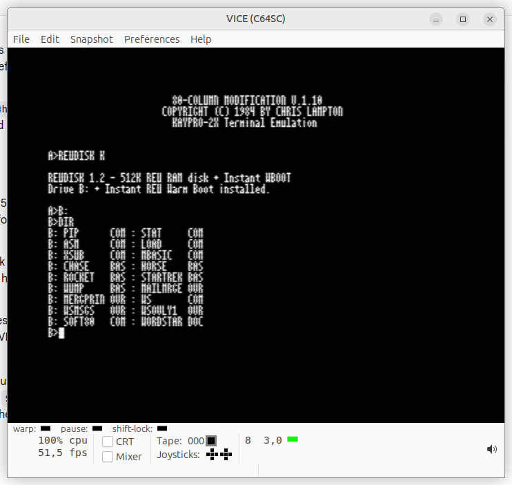

# Proof of concept REU driver for Vice c64 Emulator and cp/m cartridge.

This will not work with plain real old hardware. please see https://github.com/magicaros/whatifwithai/blob/main/what-if-c64-cpm-reu.md as to why.

# What is this?

A REU Ramdisk driver for the C64 CP/M cartridge & CP/M 2.2, V1.2 support 44K/48K TPA size and SOFT80.COM software 80 columns drivers with a warm boot from the REU instead of reloading ccp from the boot disk in A:  

# Screenshot

